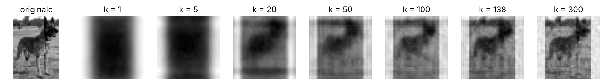
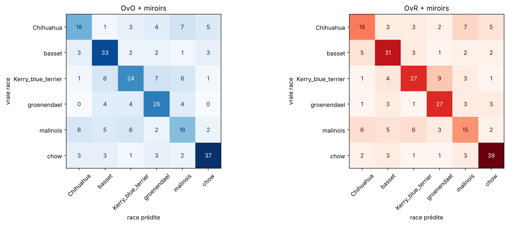

# Classification de races de chiens (PCA, HOG, SVM)

Reconnaître la race d'un chien sur une photo avec des méthodes classiques de Machine Learning, sans deep learning.

<p align="center"><br><em>Une image reconstruite avec de plus en plus de composantes principales</em></p>

## Objectif

Classer environ 1 000 photos de six races (chihuahua, basset, Kerry blue terrier, groenendael, malinois, chow). Projet du cours d'introduction au Machine Learning de Polytech Nice Sophia.

## Démarche

- Préparation des images : recadrage sur le chien à partir des annotations, passage en 64 × 64 sans déformation (letterboxing).
- Caractéristiques : une PCA apprise race par race (allure générale) et un HOG (orientation des contours).
- Premier modèle : k plus proches voisins, qui sur-apprend nettement.
- Modèle final : SVM à noyau RBF dans un `Pipeline` scikit-learn, avec des transformateurs écrits sur mesure pour la PCA et le HOG.
- Réglage des hyperparamètres par validation croisée (`GridSearchCV`).
- Comparaison des stratégies One-vs-One et One-vs-Rest.
- Augmentation des données par images miroirs.

## Résultats

| Modèle | Bonnes réponses sur le test |
|---|---|
| Hasard (6 races) | 16,7 % |
| k plus proches voisins | 44 % |
| SVM | 60 % |
| SVM + images miroirs | **62,5 %** |

En ajoutant les images miroirs avant de séparer train et test, le score montait à 66 %. C'était une fuite de données (une photo d'un côté, son miroir de l'autre), repérée puis corrigée en n'augmentant que les données d'entraînement.

<p align="center"></p>

## Outils

Python, scikit-learn, scikit-image, NumPy, Matplotlib

## Utilisation

Le code et les explications sont dans [`classification_chiens.ipynb`](classification_chiens.ipynb). Les images (base SmallDB du cours) sont téléchargées par la première cellule.

```bash
pip install -r requirements.txt
jupyter notebook classification_chiens.ipynb
```
